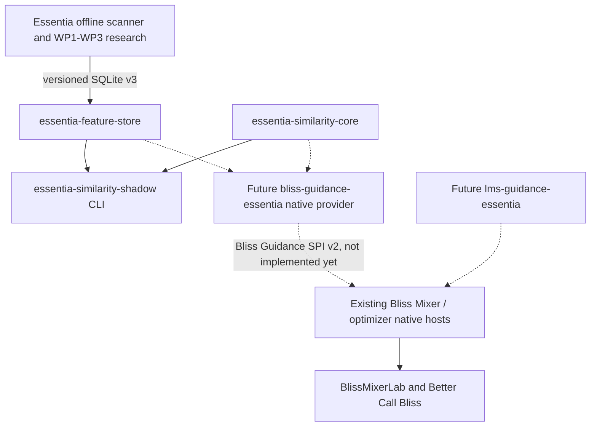

# Integration ownership and research gates

**Now implemented:** pure geometry + read-only strict source sidecar + aggregate-only shadow diagnostics + automated synthetic fixture tests. **Not implemented:** Lyrion track->exact sidecar identity resolver; actual personal metric learning/calibration; a verified high-quality General Metric; live SPI v2 process; Lab shadow UI or Better Call Bliss route scoring; portable binary packages; production model parity and licenses.

**Non-negotiable:** Never modify `bliss.db` or scanner SQLite sidecar while scoring. The baseline host retains authority over candidate selection, repeat windows and route validity. Whole-query neutral fallback when even one candidate is missing or invalid. The future adapter must implement actual `describe -> prepare -> score -> close` JSONL and let the native host choose bounded signal aggregation. The SPI does not permit adding library candidates.

**Next:** standalone compilation/CI gate; exact opaque identity equivalence tests with real Lyrion host snapshots; a pinned validated SQLite v3 coverage gate; separate SPI v2 adapter with synthetic protocol tests; only then opt-in Lab shadow reporting.
